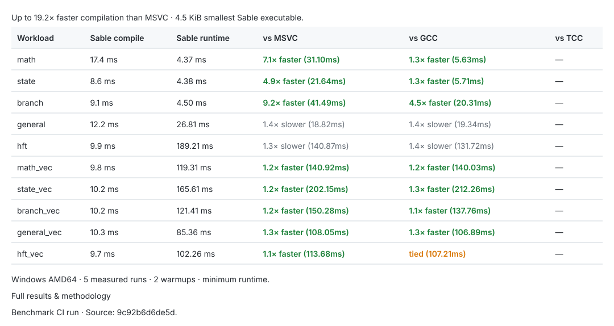

# Opus Benchmarks

Live benchmarks are measured automatically on every commit by multi-platform CI across Windows Server 2025 (x64), Windows Server 2022 (x64), Windows 11 on Arm (ARM64 Prism emulation), and Ubuntu 24.04 (Wine x64).

[](https://github.com/veriepicc/Opus/blob/ci-results/BENCHMARKS.md)

👉 **[View Complete Multi-Architecture Benchmark Results & Breakdown](https://github.com/veriepicc/Opus/blob/ci-results/BENCHMARKS.md)**

---

## Local Reproduction

To run the showdown suite locally against all detected compilers (MSVC, GCC, TCC):

```powershell
python benchmarks/run.py --iterations 5 --warmup 2
```
