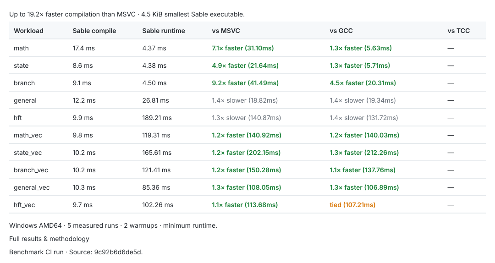
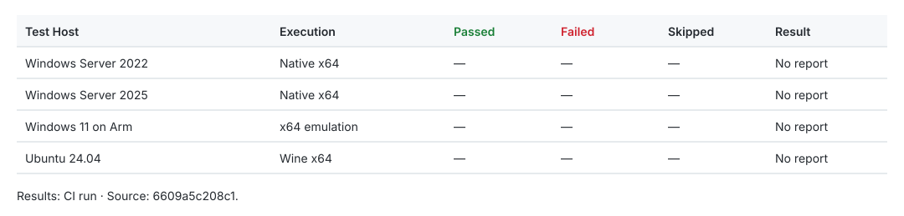

# Opus

Opus is a systems programming language and a self-contained native compiler for Windows x64. It emits PE executables and DLLs directly from source using a handwritten machine-code backend — no LLVM, no external assembler, and no linker in the toolchain.

Most of the compiler is written by hand: the x64 code generator, instruction encoding, and the PE writer are raw machine-code bytes issued directly from source, not assembled by an external tool. There is no intermediate virtual machine and no runtime layer between generated code and the operating system.

- Compile times are single-digit milliseconds on the benchmark suite. MSVC and GCC take hundreds to thousands on the same hardware.
- The compiler writes the PE file itself, including headers, sections, imports, exports, and relocations. Nothing runs afterwards.
- Small programs come out around 4 KiB.
- Three declaration syntaxes, mixable in one file: Rust-style (`fn`), scripting-style (`function`), and English.
- Binaries rarely crash. Fault recovery is built in, so an access violation gets reported with its source location and execution continues instead of taking the process down.

[Documentation](docs/index.md) · [Language reference](docs/reference.md) · [Examples](docs/examples.md) · [Benchmarks](https://github.com/veriepicc/Opus/blob/ci-results/BENCHMARKS.md) · [CI runs](https://github.com/veriepicc/Opus/actions/workflows/ci.yml)

---

## Performance

All results below are measured automatically on every commit and published to the [`ci-results`](https://github.com/veriepicc/Opus/blob/ci-results/BENCHMARKS.md) branch. Numbers are not maintained by hand.

[](https://github.com/veriepicc/Opus/blob/ci-results/BENCHMARKS.md)

The suite compares Opus, MSVC, GCC, and TCC across five workloads: scalar math, state accumulation, branch parity, mixed control flow, and an L2 order-book simulation. Each toolchain builds the same algorithm at comparable optimization levels, and each binary runs several times with warmup and minimum-runtime reporting.

Compile latency, binary size, and runtime are recorded per platform:

| Platform | Execution |
| :--- | :--- |
| Windows Server 2025 | Native x64 |
| Windows Server 2022 | Native x64 |
| Windows 11 on Arm | ARM64 Prism x64 JIT |
| Ubuntu 24.04 | Wine x64 |

**[Complete benchmark results and methodology](https://github.com/veriepicc/Opus/blob/ci-results/BENCHMARKS.md)**

## Language

```c
function int main() {
    print("Hello, World!\n")
    return 0
}
```

Semicolons are optional. The same function can be written in any of the three styles:

```rust
// Rust-style
fn add(left: int, right: int) -> int {
    return left + right
}
```

```c
// Scripting-style
function int add(int left, int right) {
    return left + right
}
```

```text
// English-style
define function add with left as int, right as int returning int
    return left + right
end function
```

All three can appear in the same file.

Beyond the basic syntax, there are structs, classes and methods, enums, imports, and project files. Function pointers are typed, threads use `spawn` / `await`, and parallel loops and atomics are available directly. The standard library is organized by module.

## Build and Run

Build the compiler once, then use `opus.exe` directly:

```powershell
./tools/ci-build.ps1
opus.exe --run examples/hello.op
```

Prerequisites are MSVC with C++ modules support and the Windows SDK. Building a project or producing a DLL is covered in [getting started](docs/getting-started.md).

Compile a source file to a native executable:

```powershell
opus.exe examples/hello.op
```

By default the compiler emits a Windows x64 executable next to the source. `--dll` switches the output to a DLL with generated exports. `--run` compiles and executes a temporary binary.

## CI

[](https://github.com/veriepicc/Opus/blob/ci-results/README.md)

[](https://github.com/veriepicc/Opus/blob/ci-results/README.md)

Every commit builds the compiler with MSVC on Windows Server 2022. The test suite then runs on four configurations: Windows Server 2025 and Windows Server 2022 natively, Windows 11 on Arm under Prism x64 emulation, and Ubuntu 24.04 under Wine x64. Benchmarks run on all four as well.

Generated reports and SVG tables go to the `ci-results` branch only. `main` stays free of automated commits.

## Tests

Python 3.10 or newer:

```powershell
python tests/run.py --verbose --report test-results.json
python tests/test_runner.py
```

The test manifest covers compilation, diagnostics, execution, projects, memory, concurrency, FFI, and stress cases. Interactive GUI tests are skipped. Fault-recovery cases must report the originating fault, continue execution, and return the expected result.

On Linux, install Wine and Xvfb, then use `python3` with the same commands. The runner allocates a private display and a disposable Wine prefix, and does not touch an existing user configuration.

## Benchmarks

Run the suite locally against every detected compiler:

```powershell
python benchmarks/run.py --iterations 5 --warmup 2
```

The runner detects Opus, MSVC, GCC, and TCC, compiles each workload, measures compile latency, binary size, and execution runtime, and writes `benchmark-results.json`, `benchmark-summary.md`, and `BENCHMARKS.md`.

## Documentation

| Guide | Reference |
| :--- | :--- |
| [Getting started](docs/getting-started.md) | [Language reference](docs/reference.md) |
| [Language overview](docs/language-overview.md) | [Builtins](docs/builtins.md) |
| [Examples](docs/examples.md) | [Standard library](docs/stdlib.md) |
| [Classes](docs/classes.md) | [Concurrency](docs/concurrency.md) |
| [DLL output](docs/dll.md) | [Debugger & recovery](docs/debugger.md) |
| [SIMD](docs/simd.md) | |

## Source Layout

| Directory | Contents |
| :--- | :--- |
| `src/` | Compiler front end, x64 emitter, and PE writer |
| `stdlib/` | Standard library |
| `tests/` | Test sources, manifest, and Python runner |
| `benchmarks/` | Benchmark sources and measurement runner |
| `examples/` | Example programs |
| `docs/` | Language and toolchain documentation |
| `tools/` | Build and CI utilities |

## Status

Opus targets Windows x64. The compiler, language surface, and standard library are under active development, and syntax or ABI details may change between revisions.

## License

[GPL-3.0-or-later with the Opus Runtime Exception](LICENSE). Programs compiled with Opus may be distributed under their own licenses.
